# Faces

Hero screens draw a face in code: a shaded body and two dark eyes, with no mouth.
The same routine covers idle, listening, thinking, speaking before the text arrives, boot,
connecting, pairing, offline, errors, questions and short cards. Reply text still replaces the
face until it times out.

The pose is a function of the frame counter and the style the app passes in. The renderer
never reads a clock and never draws a random number, so the same model is the same pixels.

The body is about 68% of the free square, with a margin so the caption does not sit on it.
Colour runs in a smooth diagonal from a light top-left to a deeper bottom-right of the same
hue, with ordered 4×4 Bayer dither so the 16-bit steps do not band. The silhouette and the
eyes are coverage-antialiased against whatever is already in the framebuffer. The eyes are
`#0D0D0D`, tilted a few degrees and slightly uneven from each other, with tapered ends.

## What the watch shows

The activity names and the hold times below follow the Grok Bot iOS app, version 0.18.0.
The table was extracted by [grok-icon-study](https://github.com/blessonism/grok-icon-study)
(unofficial; not published by xAI). This firmware does not ship that extract. The poses,
the gradient and the timing code are written for this project. Blink spacing still follows
zongzhu-bot, because that schedule is what the host tests lock in; the app's own idle blink
window is slower (about 6–14 s) and is cited here only as reference.

| App state | On this watch | What you see |
|---|---|---|
| idle | Ready, boot, short cards, waiting for the user | Neutral circle. Blinks, glances, a slow breath. After the first second, an occasional reaction for about 1.2 s (curious, playful, proud, shy, wink, surprised, wide eyes), then about 3 s of neutral. After about 30 s the body sometimes eases into a pebble, a squircle or a triangle and back |
| listening, dictating | Microphone recording, and a question | Attentive. The eyes grow with the microphone level |
| thinking | Waiting for the server, and the status line is empty | The body and the eyes morph into three dots (mid, light, dark). They pulse until the reply starts, then morph back. Looking up is only the start of that morph |
| working | Thinking, and Hermes sent a status phrase that is not a search | The body stays. The eyes take the curious pose. The headline says Working |
| searching | Thinking, and the status phrase contains "search" | The body stays. Wide eyes. The headline says Searching |
| receiving, speaking | TTS playing, before any reply text | The eyes bounce with the speaker level. The first moment back from the three dots is a short surprised pose |
| loading | Connecting, and a firmware update | A whirl of thin green, teal, purple and yellow elliptical rings around the body. Updating uses a triangle body; connecting keeps the circle |
| orbit | Mandy relaying to another persona | Not shown. This protocol has no event for that hand-off |
| alerting | Error, or anything else that needs attention on the error screen | A red exclamation mark and no body |
| sleeping | Offline for about 7 s, ready and untouched for about 25 s | The body fades to a single dot. Until then, offline is two small sleepy dots on a dim disc |
| powering-down | The screen has dimmed on its way to the backlight timeout | The same fade to one dot, then the panel turns off as before |
| waking | Leaving sleep or the dimmed fade, because something happened | The dot grows back into the body over about 0.8 s |
| happy, celebrate | A successful reply just finished | Two short, nearly level dashes for about 3 s. Celebrate uses the same smile. Text replies wait out the 20 s linger first |
| confused | The turn failed and there is no reply text | For about 3 s once the face is back: one eye open, the other a flat dash, on the blue body. The notice line is unchanged |
| other reactions (curious, playful, proud, shy, wink, surprised, and wide eyes) | Occasional idle variety | See idle. Each hold is about 1.2 s, which is the app's onboarding cadence (`k_t` is 1.5 s; the poses' own holds in the extract are longer and are not copied one-for-one) |

A successful reply arms the smile. A failure arms the confused pose and does not smile.
There is no separate "server is in a tool" flag. A non-empty `status` phrase is the only
signal Hermes sends, so working and searching are that phrase, and anything without one
stays on the three-dot thinking morph.

## Changing colours and timing

Colours are RGB888 constants in `firmware/core/include/hg/face.hpp`:

| Constant | What it is |
|---|---|
| `kBlueHi*`, `kBlue*`, `kBlueShade*` | Light, middle and deep stops of the default gradient. `kBlueCore*` is the lighter gloss mixed into the palette |
| `kRed*` | The error mark, and the red gradient stops (the idle-red range: light `#F8C4BC`, middle `#EC665E`, deep `#E25A52`) |
| `kDim*` | The offline gradient, a dimmer blue |
| `kEye*` | Both pupils |

`rgb565()` quantises them. The disc adds a Bayer threshold first, so neighbouring stops stay
distinguishable.

Timings assume one face frame is 33 ms (`kFaceFrameMs` in `firmware/core/src/app.cpp`). The
schedules are in `firmware/core/src/face.cpp` and `app.cpp`:

| Constant | What it changes |
|---|---|
| `kBlinkWindow`, `kBlinkBase`, `kBlinkJitter` | Gap between blinks. With the current numbers the gap is 78 to 180 frames, 2.6 s to 6.0 s. Every fifth blink is a double. Sleep, the error mark and the sleepy offline pose do not blink |
| the `pulse()` table | Close, hold, open. The current table is 2, 1 and 4 frames, about 70 ms, 30 ms and 140 ms |
| `kGlanceWindow`, `kGlanceJitter` | Gap between glances, 36 to 104 frames, 1.2 s to 3.5 s. One glance in four stays put |
| `kEase` | How fast a glance eases in and out (`1 - exp(-dt·k)`, k ≈ 11/s) |
| `kBreathAmp` | Idle breathing added to the eye height, thousandths of the disc |
| `kSpeakAmp`, `kSpeakVoice` | Speaking bounce. The base term plus the speaker level, about 5.2 Hz |
| `kHappyFrames` in `app.cpp` | How long the smile lasts, in face frames (90 is about 3 s) |
| `kConfusedFrames`, `kSurpriseFrames` | Failed-turn pose, and the short surprise as a voice reply begins |
| `kFaceSleepReady`, `kFaceSleepOffline` | Frames before the collapse to one dot |
| `kReactionRest`, `kReactionHold` | Idle variety: rest, then one reaction. The hold matches the ~1.2 s onboarding cadence |
| `kShapeStart` | Face frame before the body will leave the circle. Early frames stay a circle so a partial flush never has to repaint a morphing silhouette |
| `kBandAbove`, `kBandBelow` | The rows a partial flush covers. A pose that leaves this band leaves a trail |

Poses are in `pose_left` and `pose_right`. `x`, `y`, `w` and `h` are thousandths of the disc
diameter, origin at the centre, and `tilt` is degrees clockwise (screen y grows down).
`UiModel::face_reaction` selects an idle pose on Ready: 1 curious, 2 playful, 3 proud,
4 shy, 5 wink, 6 surprised, 7 wide, 8 confused. 0 keeps the screen's own pose.

The blink spacing, the one-in-five double blink, the glance spacing and the exponential ease
are adapted from [zongzhu-bot](https://github.com/Liu-zhongxian/zongzhu-bot) (MIT). The
drawing is original. See [NOTICE](../NOTICE).

While a hero face is on screen and the display is awake, the app steps a face clock about
every 33 ms (about 30 fps). Every other screen stays on the 100 ms frame. Only the rows the
eyes can touch are flushed, unless the body itself is changing (the thinking morph, a shape
blend, the loading rings, or the sleep collapse), in which case the flush covers the body
and the rings. The body is painted inside that clip, so an eye-band flush does not leave a
trail. A settled three-dot pose flushes only the dot row.

The watch's QMI8658 is not read by this firmware, so the face does not parallax with tilt.

Host renders of each state, from the 410×486 watch window:

| Ready | Listening | Thinking | Speaking |
|---|---|---|---|
| 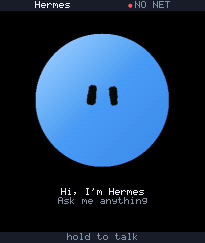 | 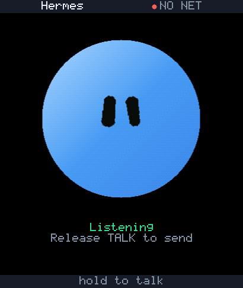 | 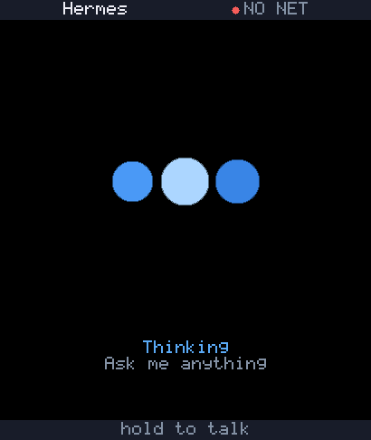 |  |

| Error | Pairing | Connecting | Offline |
|---|---|---|---|
| 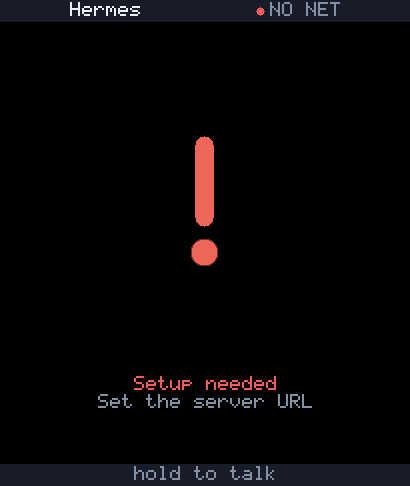 | 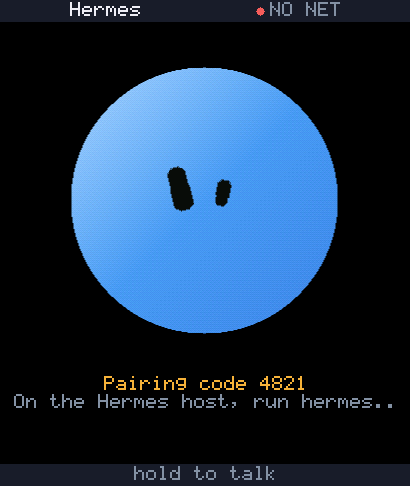 | 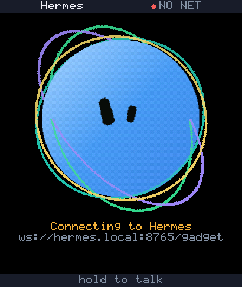 | 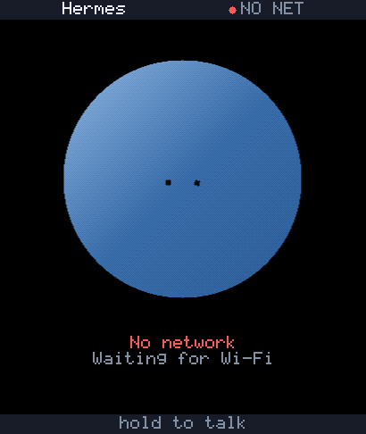 |

| Happy | Blink | Question | Boot |
|---|---|---|---|
| 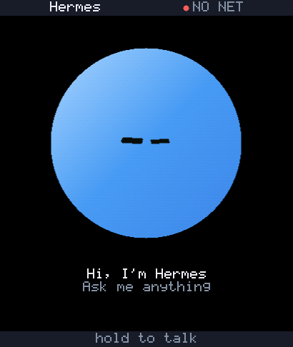 | 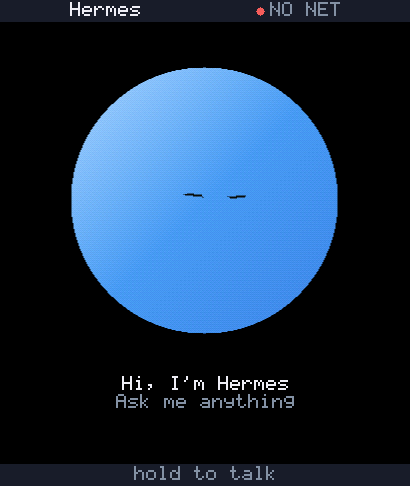 | 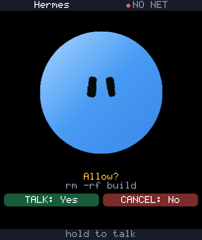 | 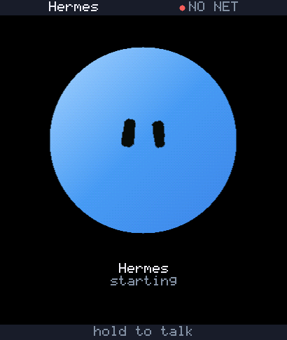 |

| Sleep | Updating |
|---|---|
| 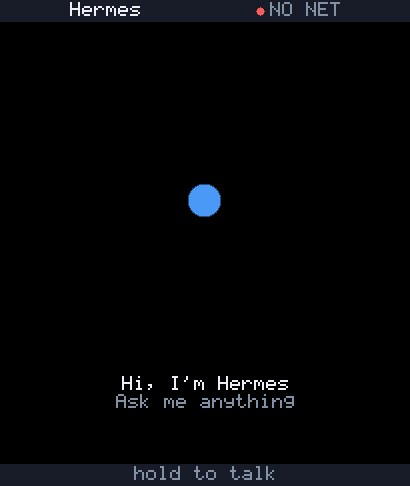 | 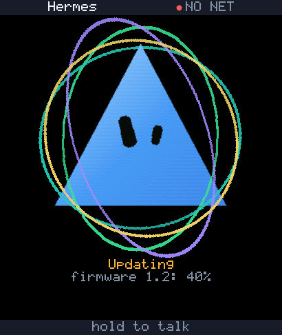 |

The expressions on one sheet (neutral through the three-dot pose):

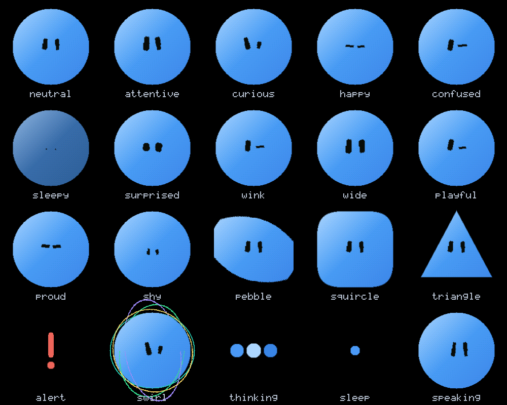

Idle, including a glance and a blink, at the face clock:

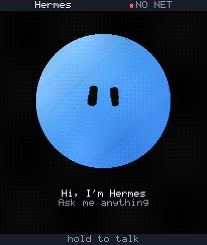

Thinking, from the body into the three dots and back:

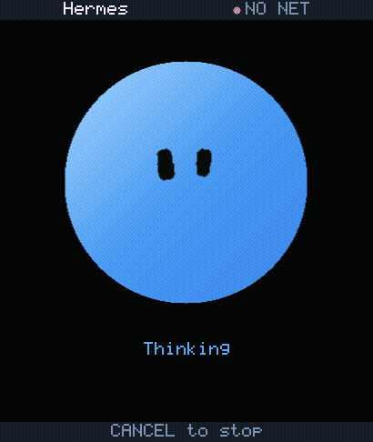

## The bitmap generator

`hermes-gadget face` still turns a picture into 1-bit frames in
`firmware/core/src/mascot_data.cpp`. **The screen does not draw those frames.** The hero
layout calls `hg::face` instead, and a build that drops unreferenced sections does not link
the bitmaps. The generator and its tests stay so the old artwork can still be reproduced.
What follows is that generator. It does not change the face on the device.

Artwork in this repository, in examples and in tests is original artwork. A picture of a real
person belongs on your own device and nowhere else, and this project is independent of Nous
Research, so nothing here should look like an endorsement of one.

## What a drawing has to be

The screen is one bit deep: a pixel is ink or it is nothing. Whatever you feed the command
gets reduced to that, so the art has to survive the reduction:

- **Flat two-tone works.** Shading, gradients and photographic detail turn to mud, because
  everything between black and white has to go one way or the other.
- **Silhouette plus one distinguishing feature survives.** At 64 px a hair shape, a pair of
  headphones, glasses or a cap read. A likeness does not.
- **The head should fill the frame.** A face that is 6% of the frame gives an eye about 11 px
  wide on a 240x240 screen, and a blink on an 11 px eye is invisible. Cropping tighter is the
  biggest single improvement you can make.
- **Both eyes have to be drawn.** An eye in shadow, behind a visor or under a mask leaves the
  blink with nothing to close, and the blink has to be invented.

## Ask an image generator for this

```
Square 1:1 image, at least 1024x1024. A bold two-tone stencil portrait of [SUBJECT], head
and shoulders filling the frame, facing the camera or in three-quarter view. Pure black
background, the subject drawn in pure white only. Flat shapes, thick clean edges, no grey,
no gradients, no shading, no background detail, no text, no watermark, no border. Both eyes
clearly visible as light shapes, and the mouth visible.
```

Image generators hand back flat files, usually JPEG, so there is no transparency in them.
That is what `--mask` is for. Asking for a square image saves you a crop.

## Generating a face

```
hermes-gadget face my-face.png --mask bright --report
```

Three things come out of it:

| Output | What it is |
|---|---|
| `firmware/core/src/mascot_data.cpp` | The frames, ready to build. `--out` puts them elsewhere. |
| `build/face-preview.png` | The three frames at all four sizes, on the device's background |
| `build/face-check.png` | Your art with the eye boxes, lid lines, mouth and effect anchors on it |

**Look at the check image first.** It is the only way to see whether the marks landed on the
features before spending a flash.

The project's own mascot is the worked example on this page: `hermes-gadget face` with no picture
regenerates it, and every number in the tables below is hers. Running the picker on
`assets/mascot/nous-girl-white-1024.png` puts the marks on art whose answers are already known,
which is the quickest way to see what they do.

`--mask` says where the ink is in your picture:

| Value | Meaning |
|---|---|
| `alpha` | The picture carries its own transparency |
| `bright` | Ink is the light part: white art on a dark background |
| `dark` | Ink is the dark part: black art on a light background |

Generated images and screenshots need `bright` or `dark`. With none of them you get one solid
block, and the command says so rather than writing it.

Then build and flash as in [hardware.md](hardware.md), or install your build over the air from
the Hermes computer:

```
hermes gadget update "Kitchen" firmware/esp32/.pio/build/<board>/firmware.bin
```

Either way the device keeps its settings, so it stays paired and keeps its Wi-Fi, its volume
and its device key.

**Updates bring back the default face.** `hermes gadget update --latest` and the browser
installer install release firmware, which carries the shipped mascot. To keep your face on a
newer release, build that release with your `mascot_data.cpp` and install the build as above.

## Placing the eye and the mouth

The device blinks and talks, so the generator has to know where the face's features are. It
starts from the drawing's own outline and works in fractions of it, so the numbers travel
between images:

| Flag | Meaning | Default |
|---|---|---|
| `--face-x` | Horizontal centre of the face | 0.50 |
| `--eye-line` | Height of the eye centres | 0.40 |
| `--eye-span` | Distance between eye centres | 0.22 |
| `--eye-size` | Eye radius | 0.05 |
| `--eye-ratio` | Eye height against its width | 0.60 |
| `--mouth-x`, `--mouth-y` | Mouth centre | face x, 0.62 |
| `--mouth-w`, `--mouth-h` | Mouth size | 0.10, 0.045 |
| `--ear-cup` | Where the listening waves start | 0.62 0.30 |
| `--think-dot` | Where the thinking dots go | 0.82 0.11 |

A centred portrait needs nothing but the picture. These four cases need more:

- **A face that is off centre**, because the drawing's outline includes hair or shoulders:
  move `--face-x`, and `--mouth-x` if the mouth is not under the eyes.
- **A three-quarter view where the two eyes differ**, for example a far eye half the width of
  the near one: give each eye its own box. The four numbers are centre x, centre y, width and
  height, as fractions of the outline, and both eyes must be given or neither:

  ```
  --eye-left  0.2197 0.4602 0.0482 0.0746
  --eye-right 0.3826 0.4349 0.1404 0.0835
  ```

  Those are the mascot's own eyes, whose far one is a third the width of the near one and sits
  lower. They are what `hermes-gadget face` uses with no arguments.
- **An eye drawn as shadow or a mask**: `--blink dark` darkens the eye and draws the lid as a
  light line. The default, `--blink light`, covers a light eye and cuts the lid out of the
  cover, which on a dark socket reads as a white blob over the face.
- **An eye that is small in the frame**: `--eye-grow` scales the blink patch about the centre
  you placed, so the blink is still visible at 64 px. Raise it until `--report` puts you in
  the same range as the shipped mascot.

A logo or an object, with nothing to blink, can be generated as a still picture with
`--plain`.

Crop before you measure, not after: `--crop X0 Y0 X1 Y1` trims the source first, which moves
the outline and therefore every fraction above.

### Clicking the features instead of measuring them

When the numbers are hard to guess, the window takes them off the picture:

```
hermes-gadget face my-face.png --mask bright --pick
```

It opens as the device sees it, with the marks the current numbers would draw on it. Click the
centre of the near eye, then the far eye, then the mouth; press Return to leave the listening
waves and the thinking dots where the geometry put them. A click moves that mark and keeps the
size the measurement found, so a click only has to land on the feature. The window prints the
flag line for a real run, and shows it in the window to copy:

```
hermes-gadget face my-face.png --mask bright --eye-left 0.2197 0.4602 0.0482 0.0746 ...
```

R starts over, Q closes the window. `--pick` writes nothing, so a mis-click cannot touch the
artwork. It needs Tk, the same dependency the simulator window has.

The copied command uses the full image path and keeps the crop, threshold, blink mode, and
anchor positions shown in the picker. Enlarged eye and mouth sizes are already included in
the coordinates; do not add the growth flags again. On Windows, paste the command into
PowerShell. On macOS and Linux, use a POSIX shell such as Bash or Zsh. Add `--out`, `--preview`,
or `--check` to choose output files before running it.

With the project's mascot image, explicit feature coordinates generate your selected geometry.
Run `hermes-gadget face --mascot` to reproduce the original shipped frames.

## Will the blink read?

```
hermes-gadget face my-face.png --mask bright --report
```

`--report` prints how many bits each frame changes against idle, per size. The number that
decides it is the 192 px one, because that is the largest the face is drawn on a 240x240
screen. The shipped mascot changes **226 bits at 192 px** on a blink and 16 on talk, and the
test suite asserts those two numbers. Anything in that range reads on the screen; much less
and the blink is a flicker nobody notices.

## Putting the mascot back

```
git checkout -- firmware/core/src/mascot_data.cpp
```

Then build and flash. The shipped artwork is the default, and the generator reproduces it
exactly, so there is nothing to keep in sync.

## How it works

The frames are 1-bit bitmaps: row major, most significant bit first, rows padded to a whole
byte, a set bit meaning ink. Four sizes and three frames take about 27 KB. The UI no longer
reads them; [architecture.md](architecture.md) describes the face the screen does draw.

The blink and talk frames are drawn on top of the idle frame: a blink covers each eye and cuts
a closed lid into it, and a talking mouth is a hole cut into the ink. Both come from the
feature positions above, which is why those positions matter.

The effect anchors are written as thousandths of the drawn size. They belonged to the old
bitmap face. The procedural face does not read them.
